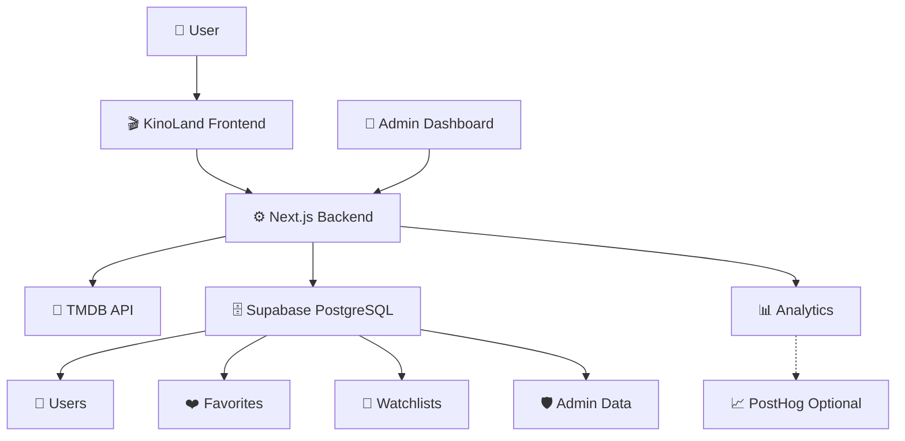

<div align="center">


# 🎬 KinoLand

### Discover. Watch trailers. Explore cinema.

**A modern, full-stack cinematic movie discovery platform.**

[](https://kinoland-thec.onrender.com/)
[](https://github.com/Sailauov08/KinpLand)

<br>


<br>

🌍 **English · Русский · Қазақша**

---

**Explore movies. Discover favorites. Build your watchlist.**

</div>

## 🌟 About KinoLand

**KinoLand** is a full-stack movie discovery platform designed to provide a premium cinematic experience.

Discover trending movies, explore top-rated films, watch official trailers, and create your personal watchlist.

Powered by **TMDB API**, KinoLand delivers real movie metadata, posters, ratings, and cast information.

The application also includes secure authentication, persistent user data, analytics, and a protected administration dashboard.

### 🔗 Live Website

🌐 **https://kinoland-thec.onrender.com/**

> The free hosting instance may take some time to wake up after inactivity.

---

## ✨ Key Features

| Feature | Description |
|---------|-------------|
| 🎬 Movie Discovery | Explore trending and popular films |
| 🏆 Top 100 | Discover highly rated movies |
| 🔍 Advanced Search | Search by title, genre, year and rating |
| ⭐ Ratings | Real TMDB ratings and reviews data |
| 🎭 Cast & Crew | Actor and director information |
| 🎞️ Trailers | Watch official movie trailers |
| ❤️ Favorites | Save your favorite movies |
| 📌 Watchlist | Create your personal watchlist |
| 🤖 Recommendations | Discover movies based on preferences |
| 🌍 Multilingual | English, Russian and Kazakh |
| 🔐 Authentication | Secure registration and login |
| 📊 Analytics | Monitor user engagement and traffic |
| 🛡️ Admin Panel | Manage users, content and analytics |
| 📱 Responsive | Optimized for desktop, tablet and mobile |

---

## 🎨 User Experience

KinoLand features a premium cinema-inspired interface.

- 🌑 Elegant dark theme
- 🟡 Refined golden accents
- 🎥 Cinematic movie backgrounds
- ✨ Smooth animations and transitions
- 🧩 Reusable interface components
- 📱 Mobile-friendly navigation
- ⚡ Optimized loading experience
- 🎯 Intuitive movie discovery

---

## 🛠️ Technology Stack

### Frontend

| Technology | Purpose |
|------------|---------|
| ⚛️ Next.js | Full-stack React framework |
| 🔷 TypeScript | Type-safe development |
| 🎨 React | Interactive user interface |
| 💅 CSS | Responsive styling |

### Backend & Database

| Technology | Purpose |
|------------|---------|
| 🟢 Node.js | Server-side runtime |
| 🐘 PostgreSQL | Persistent database |
| ⚡ Supabase | Cloud PostgreSQL hosting |
| 💾 PGlite | Local development database |
| 🔐 Server-side Auth | Authentication and sessions |

### APIs & Integrations

| Service | Purpose |
|---------|---------|
| 🎬 TMDB API | Movie information and images |
| 📊 PostHog | Optional product analytics |
| ☁️ Render | Cloud hosting |
| 🐙 GitHub | Source code and version control |

---

## 🏗️ System Architecture



### How it works

**1. User Interface**

Users interact with KinoLand through a responsive Next.js application.

**2. Backend**

Next.js handles authentication, protected routes, API requests, and database operations.

**3. Movie Data**

TMDB provides movie metadata, posters, ratings, and trailer references.

**4. Database**

Supabase PostgreSQL stores accounts, sessions, favorites, watchlists, and administrative data.

**5. Analytics**

First-party analytics records relevant website events and usage statistics.

---

## 🛡️ Admin Dashboard

KinoLand includes a protected administration system.

**Admin route:** `/admin`

### Dashboard Features

| Section | Function |
|---------|----------|
| 📊 Overview | Website statistics |
| 👥 Users | User management |
| 📈 Analytics | Visitor and engagement metrics |
| 🎬 Movies | Movie popularity statistics |
| 🔍 Search Analytics | Search activity |
| ❤️ Watchlists | Watchlist statistics |
| 🎛️ Content | Homepage and banner management |
| 💚 System Health | Database and API monitoring |
| ⚙️ Settings | Administration settings |

### Security

- ✅ Role-based authorization
- ✅ Protected admin API routes
- ✅ Server-side session validation
- ✅ Password hashing
- ✅ Secure database access
- ✅ Administrative audit logs
- ✅ Rate limiting
- ✅ Environment-based secrets

---

## 🗄️ Database Architecture

KinoLand uses **PostgreSQL hosted on Supabase**.

Application data is stored in a private database schema.

### Database Tables

| Table | Description |
|-------|-------------|
| `users` | Registered user accounts |
| `sessions` | Authentication sessions |
| `list_items` | Favorites and watchlists |
| `events` | Analytics events |
| `daily_salts` | Privacy-preserving visitor identifiers |
| `error_log` | Application errors |
| `audit_log` | Administrative activity |
| `banners` | Homepage banners |
| `hidden_movies` | Movie visibility settings |
| `provider_links` | Approved watch-provider links |
| `settings` | Application configuration |
| `schema_migrations` | Database schema versions |

Database queries run on the server.

Sensitive database credentials are not exposed to the browser.

---

## 🚀 Getting Started

### Prerequisites

- Node.js 22.13+
- npm
- TMDB API Key
- Supabase PostgreSQL connection for cloud deployment

### 1. Clone Repository

```bash
git clone https://github.com/Sailauov08/KinpLand.git
cd KinpLand
```

### 2. Install Dependencies

```bash
npm install
```

### 3. Environment Configuration

Create an `.env.local` file.

```env
TMDB_API_KEY=your_tmdb_api_key
DATABASE_URL=your_postgresql_connection_url
NEXT_PUBLIC_SITE_URL=http://localhost:3000
```

For local development, `DATABASE_URL` can be omitted to use the embedded PGlite database.

**Never commit `.env.local` or private credentials.**

### 4. Start Development Server

```bash
npm run dev
```

Open:

http://localhost:3000

### 5. Production Build

```bash
npm run build
npm start
```

---

## 🧪 Testing

KinoLand uses automated tests and development quality checks.

| Command | Description |
|---------|-------------|
| `npm run dev` | Start development server |
| `npm run build` | Production build |
| `npm run typecheck` | TypeScript verification |
| `npm run lint` | ESLint checks |
| `npm test` | Automated tests |
| `npm run db:migrate` | Apply database migrations |
| `npm run db:import-sqlite` | Import legacy SQLite data |

Testing covers authentication, database operations, administrator permissions, and other application functionality.

---

## ☁️ Deployment

KinoLand uses the following deployment infrastructure:

| Platform | Role |
|----------|------|
| 🐙 GitHub | Source code repository |
| ☁️ Render | Next.js application hosting |
| 🟢 Supabase | Cloud PostgreSQL database |
| 🎬 TMDB | Movie data provider |

### Production Website

**[🌐 Open KinoLand](https://kinoland-thec.onrender.com/)**

Render deployment is configured using `render.yaml`.

Environment variables must be configured in the hosting dashboard.

---

## 📁 Project Structure

```text
src/
│
├── app/
│   ├── admin/
│   ├── api/
│   └── ...
│
├── components/
│
├── lib/
│   ├── admin/
│   ├── analytics/
│   ├── auth/
│   ├── db/
│   ├── i18n/
│   └── movies/
│
└── proxy.ts
```

---

## 🔒 Privacy & Security

KinoLand is designed with security and privacy considerations.

- Passwords are stored using secure hashes.
- Session tokens are hashed.
- Authentication and admin permissions are validated server-side.
- Database secrets remain on the server.
- Analytics avoids storing IP addresses.
- Sensitive search content is filtered.
- Optional PostHog tracking requires consent.

---

## 🎥 Movie Content

KinoLand uses **The Movie Database (TMDB)** for movie metadata, images, ratings, and trailer information.

**KinoLand uses TMDB and the TMDB APIs but is not endorsed, certified, or otherwise approved by TMDB.**

TMDB does not provide full-length movie streams.

KinoLand currently focuses on movie discovery, official trailers, and approved watch-provider links.

---

## 🗺️ Future Improvements

- 🎞️ Authorized full-length movie streaming
- 🤖 Advanced AI movie recommendations
- 📱 Progressive Web App
- 🔔 Personalized notifications
- ⭐ Personal movie reviews
- 🌐 Additional localization
- 📊 Advanced administrator analytics
- 🎬 Extended movie discovery features

---

## 👨‍💻 Developer

Created and developed as a full-stack portfolio project.

**GitHub:** [Sailauov08](https://github.com/Sailauov08)

**Project:** [KinoLand Repository](https://github.com/Sailauov08/KinpLand)

**Live:** [KinoLand Website](https://kinoland-thec.onrender.com/)

---

<div align="center">

### 🎬 KINOLAND

**Every film. One universe.**

Built with ❤️ using Next.js, TypeScript, Supabase and TMDB.

[🌐 Live Demo](https://kinoland-thec.onrender.com/) · [💻 GitHub](https://github.com/Sailauov08/KinpLand) · [🎥 TMDB](https://www.themoviedb.org/)

---

© 2026 KinoLand

</div>
